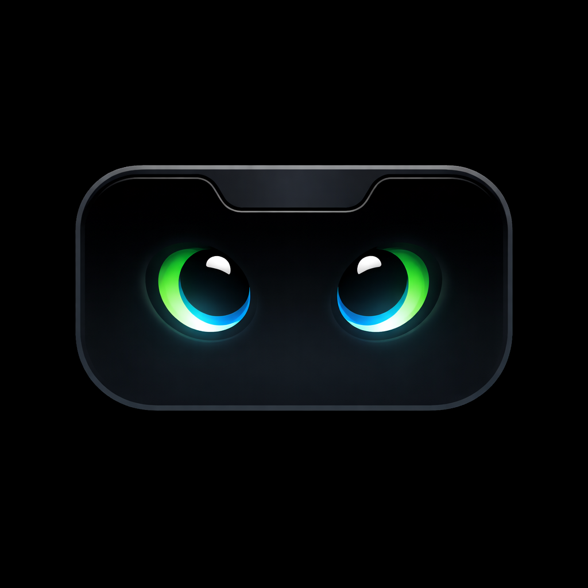
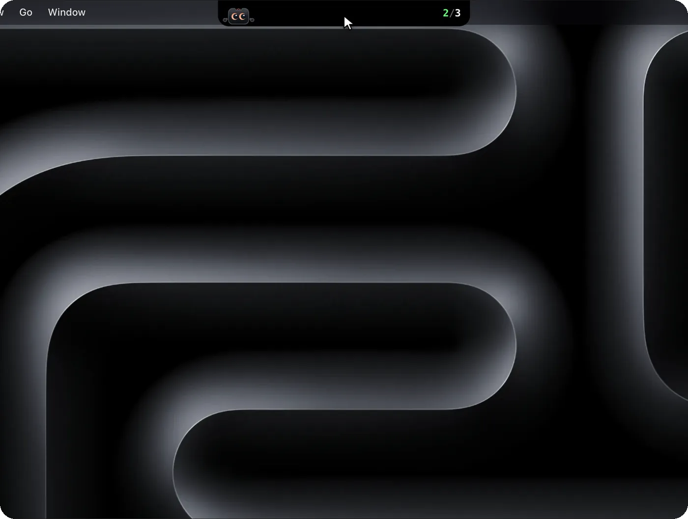
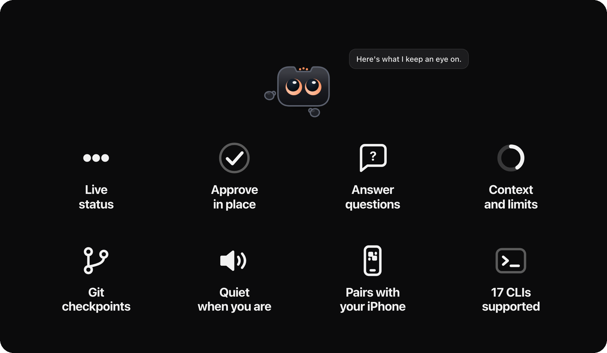
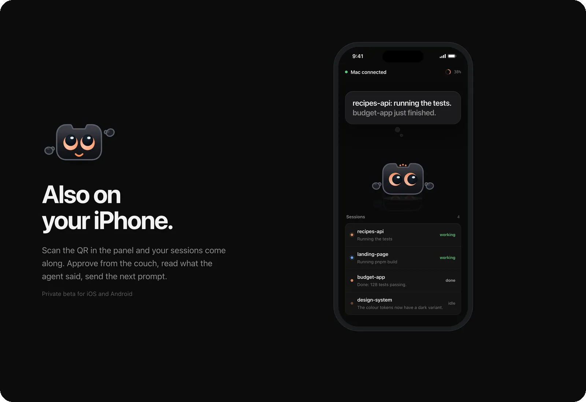
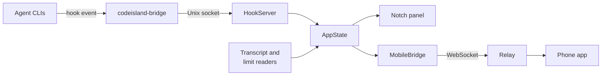

<p align="center">
  
</p>

<h1 align="center">Hatchling</h1>

<p align="center"><b>Your coding agents, in the notch.</b><br>
See which agent is working and which one is waiting on you.<br>
Approve, answer and get back to what you were doing.</p>

<p align="center">
  <a href="https://github.com/MikaelDDavidd/hatchling/releases/latest"><b>Download for Mac</b></a>
  &nbsp;·&nbsp;
  <a href="https://hatchling.mikaeldavid.dev">Website</a>
  &nbsp;·&nbsp;
  <a href="CHANGELOG.md">Changelog</a>
  <br>
  <sub>Free and open source · macOS 14 or later · Apple Silicon and Intel</sub>
</p>

<p align="center">
  
</p>

Hatchling is a macOS notch panel for every AI coding agent you run: Claude Code, Codex, Gemini CLI, Cursor, Copilot and 12 more.

<p align="center">
  
</p>

## What it does

- **Live status for 17 CLIs.** Each CLI gets a hook that reports over a local Unix socket. When the notch is closed it cycles through the sessions that need you first.
- **Approve and answer in place.** Permission requests and agent questions become cards. Answer with the mouse, or with Return, Esc and 1 to 9. "Always allow" stays narrow, and accepting a plan asks first unless YOLO mode is on.
- **Context and limits.** Model and context window for each Claude Code session, Claude's 5-hour and 7-day limits read through the Claude Code CLI, Codex limits from its local files, and a warning when usage passes 70%.
- **Hatch.** One mascot for all your sessions. It reacts to what the agents do and presents finished runs, with an optional AI summary (Anthropic, or NVIDIA's free API; the key stays in the Keychain).
- **Files, notes and checkpoints.** Drop files on the notch to keep them in a tray, keep notes in the panel, and snapshot the working tree with a shortcut before an agent edits it.
- **Stays out of the way.** Sounds go quiet during calls, the Mac stays awake while an agent works, and the app updates itself when idle.

<p align="center">
  
</p>

## On your phone

Scan the QR code in the panel and your sessions come along: read the conversation, approve, answer and send the next prompt. The Mac talks to the phone through a relay and opens no network port. Sending a prompt needs the session running in tmux, or Accessibility access. The iOS and Android app is in private beta.

## How it works



- **Three targets.** `CodeIslandCore` holds the models, the event normalizer and the phone protocol, so they test without the app. `codeisland-bridge` is the small binary each hook calls. `CodeIsland` is the app.
- **One protocol, three languages.** The Mac (Swift), the relay (TypeScript) and the phone app (Kotlin) share one versioned protocol. The Mac side is tested against a real relay over a real socket.
- **Measured performance.** Idle, the panel used 14.9% of a core. Profiling showed AppKit keeping the window in continuous layout whenever anything redraws more often than every 250 ms. Moving the animations past that line brought it to 4%. The panel also stopped polling every 500 ms, and session discovery now rescans only when session files appear.

## Install

Download the `.dmg` from [Releases](https://github.com/MikaelDDavidd/hatchling/releases/latest) and drag **Hatchling.app** into **Applications**. On first launch it adds its hooks to each CLI it finds (`~/.claude/settings.json`, `~/.codex/hooks.json`, `~/.gemini/settings.json`, `~/.cursor/hooks.json` and others). To read Claude's limits it wraps your Claude Code statusline; your original command is kept at `~/.codeisland/statusline-original.cmd` and still runs.

## Build from source

Requires macOS 14 or later and a recent full Xcode install (`build.sh` compiles the icon with `actool`).

```bash
git clone https://github.com/MikaelDDavidd/hatchling.git
cd hatchling
./build.sh
open .build/release/Hatchling.app
```

The result is a universal binary, signed with the Apple identity in your keychain or ad-hoc if there is none. `--notarize` also notarizes and builds a signed DMG.

```bash
swift test   # 148 tests in 26 files
```

## Heritage

Hatchling is a hard fork of [`wxtsky/CodeIsland`][cs], which was inspired by [`farouqaldori/claude-island`][ci]. The hook server, the panel shell, remote hosts over SSH, the global shortcuts and most of `AppState` come from upstream. The buddy's WyHash and species data are adapted from [`MioMioOS/MioIsland`][mio] (CC BY-NC 4.0). Two sounds, the microphone check, git checkpoints and sleep prevention come from [`bones7456/notchy`](https://github.com/bones7456/notchy); see [THIRD-PARTY.md](THIRD-PARTY.md).

About half of the code that ships today was written for Hatchling, including:

- Hatch, its moves, remarks and memory (`HatchlingMascot`, `HatchProfile`, `HatchCompanion`)
- The phone link: protocol, bridge, pairing and phone panel, plus the relay and the Kotlin app in a separate repo
- Claude and Codex limit readers (`ClaudeRateLimitReader`, `CodexUsage`) and the usage alerts
- The conversation view (`TranscriptReader`) and AI summaries (`AIText`, `MomentSummary`)
- Files tray, notes, keyboard answers, idle self-update with a signature check
- The Portuguese localisation, the panel redesign and the performance work above

## License

MIT, like upstream. See [LICENSE](LICENSE). The buddy data files keep MioIsland's CC BY-NC 4.0 license.

If Hatchling saves you a few trips to the terminal, you can [buy me a coffee](https://buymeacoffee.com/mikaeldavid) or [sponsor on GitHub](https://github.com/sponsors/MikaelDDavidd).

[cs]: https://github.com/wxtsky/CodeIsland
[ci]: https://github.com/farouqaldori/claude-island
[mio]: https://github.com/MioMioOS/MioIsland
